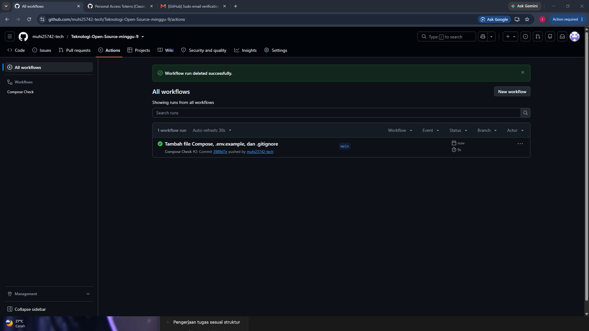
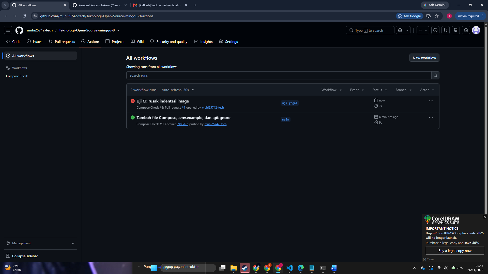
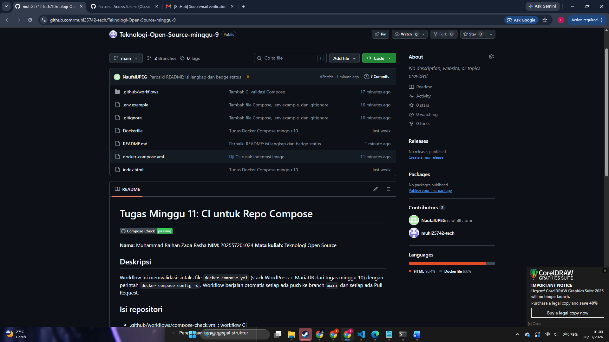

# Tugas Minggu 11: CI untuk Repo Compose

**Nama:** Muhammad Raihan Zada Pasha
**NIM:** 202557201024
**Mata kuliah:** Teknologi Open Source

## Deskripsi

Workflow ini memvalidasi sintaks file `docker-compose.yml` (stack WordPress + MariaDB dari tugas minggu 10) dengan perintah `docker compose config -q`. Workflow berjalan otomatis setiap ada push ke branch `main` dan setiap ada Pull Request.

## Isi repositori

- .github/workflows/compose-check.yml : workflow CI
- docker-compose.yml : stack WordPress + MariaDB (tugas minggu 10)
- .env.example : contoh variabel lingkungan tanpa rahasia asli
- .gitignore : mengabaikan .env

## Cara kerja workflow

Workflow dipicu oleh dua kejadian, yaitu push ke branch main dan pull_request. Ada satu job bernama validate yang berjalan di runner ubuntu-latest. Job ini punya tiga step. Step pertama, actions/checkout, mengunduh isi repo ke runner. Step kedua menyalin .env.example menjadi .env karena file .env asli tidak ada di repo. Step ketiga menjalankan docker compose config -q untuk memeriksa sintaks file Compose tanpa menjalankan container. Jika ada kesalahan, job berwarna merah.

## Bukti

1. Run hijau di tab Actions

2. Pull Request dengan check gagal (merah)

3. Badge status di README

Tautan Pull Request (sudah hijau dan di-merge): [tempel tautan PR di sini]

## Kendala dan cara mengatasinya

Run pertama di tab Actions berwarna merah di step "Siapkan .env dari contoh" dengan pesan error `cp: cannot stat '.env.example': No such file or directory`. Penyebabnya, saya baru mem-push folder .github, sedangkan .env.example belum ada di repo sehingga runner tidak menemukannya. Saya memperbaikinya dengan menambahkan docker-compose.yml, .env.example, dan .gitignore lewat git add, commit, lalu push. Setelah itu run berubah hijau.

## Refleksi singkat

CI membuat file Compose saya diperiksa otomatis setiap ada perubahan, sehingga kesalahan sintaks ketahuan sebelum digabung ke main. Pada tugas ini terlihat bahwa Pull Request yang merah mencegah perubahan rusak masuk, dan setelah diperbaiki check hijau memberi kepercayaan untuk melakukan merge.
